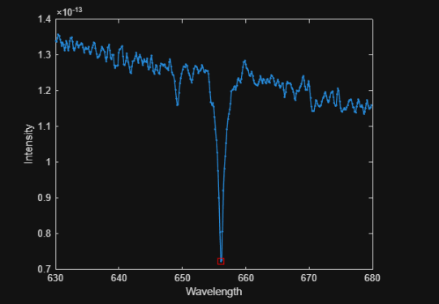

# Stellar Motion (MATLAB)

A MATLAB project that estimates the velocity of a star from the Doppler shift of its hydrogen absorption line.

Based on the Stellar Motion project from MATLAB Onramp.

## Background

Hydrogen, a major component of most stars, absorbs light at exactly 656.28 nm (the H-alpha line). If a star is moving relative to Earth, this absorption dip appears at a different wavelength:

- **Redshift** (dip at a longer wavelength): the star is moving away.
- **Blueshift** (dip at a shorter wavelength): the star is moving toward us.

## Method

1. Build the wavelength vector from the starting wavelength, spacing, and number of observations.
2. Plot the star's spectrum (intensity vs. wavelength).
3. Find the minimum intensity, which is the hydrogen absorption dip.
4. Compute the redshift:  `z = λ_observed / 656.28 - 1`
5. Compute the speed:  `v = z · c`, where `c = 299,792.458 km/s`

## Result

Add your computed speed here, for example: `Star speed = XXX km/s`

## Data

`starData.mat` is provided by MATLAB Onramp and is not included in this repo. To run the script, download it from the course (Project: Stellar Motion).

## How to Run

1. Place `starData.mat` in the same folder as the script.
2. Open `stellar_motion.m` in MATLAB.
3. Click **Run**.

## Skills Demonstrated

- Vector creation and indexing
- Data visualization
- Finding minima in data
- Applying a physics formula (Doppler effect)

## License

MIT License. See the `LICENSE` file.
