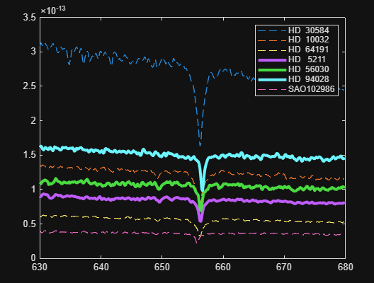

# Stellar Motion & Spectra Comparison (MATLAB)

MATLAB projects that estimate the radial velocity of stars from the Doppler shift of the hydrogen absorption line (H-alpha).

Based on the Stellar Motion and Compare Stellar Spectra projects from MATLAB Onramp.

## Background

Hydrogen, a major component of most stars, absorbs light at exactly 656.28 nm (the H-alpha line). If a star is moving relative to Earth, this absorption dip appears at a different wavelength:

- **Redshift** (dip at a longer wavelength): the star is moving away.
- **Blueshift** (dip at a shorter wavelength): the star is moving toward us.

The radial velocity follows from the redshift:

```
z = λ_observed / 656.28 - 1
v = z · c        (c = 299,792.458 km/s)
```

## Projects

### 1. Stellar Motion (single star)

Script: [`stellar_motion.m`](stellar_motion.m)

1. Build the wavelength vector from the starting wavelength, spacing, and number of observations.
2. Plot the star's spectrum (intensity vs. wavelength).
3. Find the minimum intensity, which is the hydrogen absorption dip.
4. Compute the redshift and the speed.


**Result:** Star speed = **-100.5 km/s** (negative = blueshift, the star is moving toward Earth)

### 2. Compare Stellar Spectra (7 stars)

Script: [`compare_stellar_spectra.m`](compare_stellar_spectra.m)

1. Find the absorption dip of every star at once using `min` on the spectra matrix.
2. Compute the speed of each star.
3. Plot all spectra on one figure in a `for` loop:
   - **Dashed line**: blueshift (moving toward Earth)
   - **Thick line**: redshift (moving away)
4. Add a legend and list the stars moving away from Earth.



**Stars moving away from Earth:** HD 5211, HD 56030, HD 94028

## Data

`starData.mat` is provided by MATLAB Onramp and is not included in this repo. To run the scripts, download it from the course (Project: Stellar Motion).

## How to Run

1. Place `starData.mat` in the same folder as the scripts.
2. Open `stellar_motion.m` or `compare_stellar_spectra.m` in MATLAB.
3. Click **Run**.

## Skills Demonstrated

- Vector creation and indexing
- Data visualization (multi-line plots, legends, line styles)
- Finding minima in matrix data
- `for` loops and `if`/`else` branching
- Logical indexing (`starnames(speed > 0)`)
- Applying a physics formula (Doppler effect)

## License

MIT License. See the [`LICENSE`](LICENSE) file.
